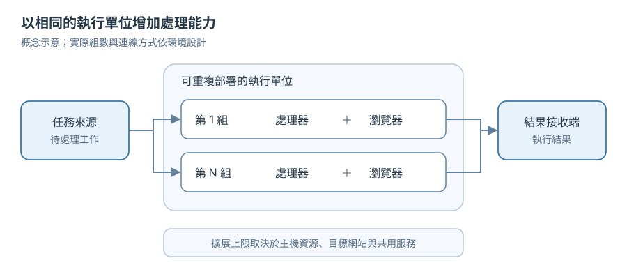

# 瀏覽器自動化工作流程容器化：部署、故障處理與水平擴展

在一個瀏覽器自動化專案中，原先以虛擬機器執行任務。每次增加產能，都要準備新的機器、安裝執行環境，再逐一確認版本與設定。這樣能運作，但擴充和維護都依賴人工步驟。

後來我把任務處理與瀏覽器操作整理成一組可重建的容器。增加處理能力時，部署更多相同的組；更新或重建其中一組時，其餘組仍可繼續工作。這篇整理容器化過程中的設計重點，以及水平擴展時真正需要驗證的條件。

下圖是去識別化的概念圖，元件名稱與連線關係僅用來說明設計模式，不代表任何特定環境的實際拓樸。

---

## 1. 把任務處理與瀏覽器操作視為一組

這組容器包含兩種職責：

- **任務處理器（worker）**：接收任務、管理執行狀態並回報結果。
- **瀏覽器執行器（browser host）**：提供瀏覽器操作所需的執行環境。

把這兩種職責一起部署，能讓每組具有相同的處理能力，也方便逐組擴充、更新與替換。各組使用一致的映像檔與設定方式；部署時再注入環境所需的參數，減少不同機器之間的版本差異。

---

## 2. 容器化不只是把程式裝進映像檔

搬到容器後，原本由虛擬機器長期保存的狀態，需要重新分類。暫存檔、下載檔與瀏覽器設定，應明確決定保留期限；可以重建的資料，就不要讓容器的存活成為任務完成的前提。

設定也需要在啟動時檢查。必要參數缺少或格式錯誤時，應盡早報錯，避免任務執行到一半才發現環境不完整。跨作業系統搬遷時，我也檢查瀏覽器的字型、縮放、輸入與捲動行為，因為自動化流程常在這些細節上出現差異。

這些調整讓部署方式變得可複製，也讓容器能在需要時重新建立，而不必逐台修復執行環境。

---

## 3. 先定義任務在故障時的結果

瀏覽器自動化任務通常比一般 API 請求長，途中可能遇到程序停止、依賴服務暫時無法使用或執行時間過長。設計重點是讓每種結束方式都有明確結果：任務已完成、可以安全重試，或需要人工確認。

重試尤其需要小心。**任務重新執行，不代表它對外部系統造成的動作可以重複。** 如果任務會送出表單或修改資料，就要依業務情境設計狀態查詢、冪等識別或補償流程。驗證時也要分別檢查「任務如何結算」與「外部操作是否重複」，不能只看任務是否重新派送。

對登入錯誤與暫時性連線錯誤，也應採不同處理方式。是否重試，要依錯誤性質與目標系統的使用政策決定，而不是讓所有失敗都進入同一套重試流程。

---

## 4. 水平擴展的上限在整條工作流程

多開執行單位可以提高同時處理任務的能力，但吞吐量不會無限線性成長。瀏覽器本身會消耗 CPU 與記憶體；任務可能還要等待網站、OCR 或其他共用服務回應。當其中一項資源先達到上限，新增容器未必能再縮短排隊時間。

| 需要量測的面向 | 為什麼要看 |
| --- | --- |
| 任務等待時間 | 判斷增加執行單位後，排隊是否真的縮短 |
| CPU、記憶體與瀏覽器資源 | 找出單組成本及主機可承載的組數 |
| 下游服務的延遲與限流 | 避免把瓶頸轉移到共用服務 |
| 失敗率與重試量 | 確認擴充沒有放大故障或重複工作 |

容量規劃最好用相同的任務組合逐步增加組數，觀察吞吐量、等待時間與錯誤率，再決定合理的擴展範圍。若使用 Kubernetes 自動增減執行單位，縮容時也要處理正在執行的任務，讓任務狀態保持一致。

---

## 5. 小結

這次容器化最有價值的改變，是讓部署單位可以重複建立，也讓擴充產能從「新增一台特別設定的機器」轉成「增加一組相同的執行單位」。要讓這個方式穩定運作，還需要把任務結算、重試、瀏覽器狀態與下游容量一起納入設計。

對瀏覽器自動化而言，擴展能力不只看能開多少容器，更要看故障發生時任務能否有明確結果，以及新增的併發是否真的改善整體處理時間。
