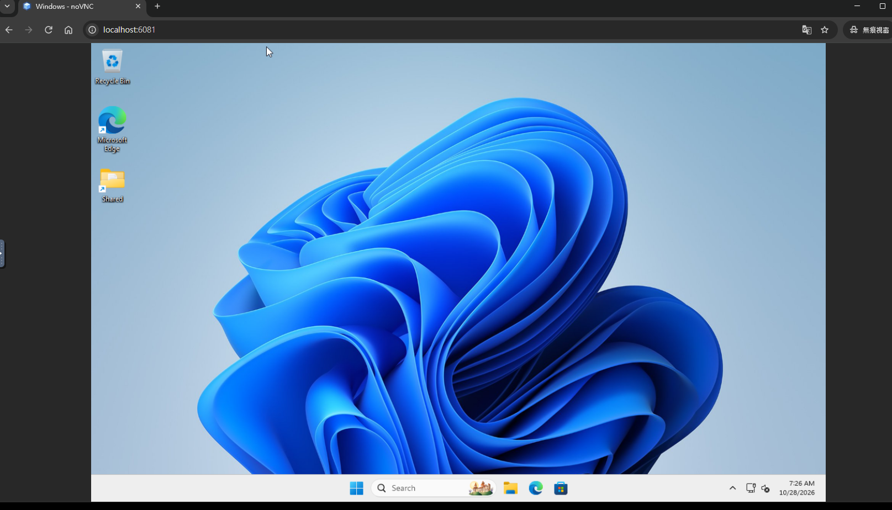

# 使用 Docker 建立多個 Windows 測試環境

## 一、目標

本篇說明如何透過 Docker Compose 建立 Windows 環境，提供 CUA 在開發、測試或驗證流程中快速部署多套彼此獨立的 Windows 執行環境。

透過容器化的管理方式，可以將 Windows 環境的映像檔、資源配置、連接埠與資料儲存路徑集中定義在 `compose.yml` 中。當需要建立第二套或更多 Windows 環境時，只要複製設定並調整連接埠與儲存位置，即可降低重複安裝與人工設定的成本。

需要特別說明的是，這個方案雖然使用 Docker Compose 管理，但 Windows 本身仍透過虛擬化機制執行。`dockurr/windows` 映像支援 KVM 加速、CPU／記憶體／磁碟配置、自訂 Windows ISO、網頁操作介面與 RDP 遠端連線。

---

## 二、適用情境

這套架構適合運用於以下場景：
- 建立彼此隔離的 Windows 測試環境
- 測試不同 Windows 版本或更新版本
- 驗證應用程式安裝流程
- 進行 CUA 自動化操作測試
- 建立可快速移除及重新部署的臨時環境
- 降低多人共用同一套 Windows 測試機所造成的設定衝突
- 為不同測試案例配置獨立的 CPU、記憶體、磁碟與連接埠

相較於在實體電腦上反覆安裝 Windows，使用 Compose 設定檔可以保留一致的基礎配置，並讓環境的重建流程更加標準化。

---

## 三、運作架構

整體流程可分為四個部分：
1. **Docker Compose**  
   負責啟動、停止及管理 Windows 執行環境。
2. **Windows ISO 映像檔**  
   作為 Windows 安裝來源，並以 `custom.iso` 的名稱掛載至執行環境。
3. **持久化儲存空間**  
   保存 Windows 系統磁碟與安裝後的資料，避免容器重新啟動時遺失內容。
4. **網頁介面與 RDP**  
   可先透過瀏覽器觀察 Windows 安裝及啟動狀況，完成安裝後也可以透過 RDP 操作。

Compose 範例會將主機的 `6081` 連接埠對應到容器的網頁介面 `8006`，並將主機的 `6080` 對應到容器的 RDP `3389/tcp` 與 `3389/udp`。

---

## 四、環境需求

開始前，請確認主機已具備以下條件：
- 已安裝 Docker Desktop 或 Docker Engine
- Docker Compose 可正常使用
- 主機已啟用硬體虛擬化
- 若在 Windows 11 上使用 Docker Desktop，必須確認執行環境支援巢狀虛擬化
- 至少保留 2 GB 可用記憶體
- 至少保留 32 GB 可用磁碟空間

實際需要的資源會依 Windows 版本、安裝的軟體與測試負載而增加。專案預設值為：
- 記憶體：`4G`
- CPU：`2` 核心
- 磁碟：`64G`

上述資源可以分別透過 `RAM_SIZE`、`CPU_CORES` 與 `DISK_SIZE` 調整。

> 若預計同時執行多套 Windows，應先計算所有環境的記憶體與 CPU 總需求，避免主機資源不足，導致 Windows 安裝失敗、回應緩慢或容器被迫停止。

---

## 五、建立第一套 Windows 環境

### 步驟 1：下載 Docker Compose 專案檔

下載以下專案：

[下載 dockur-windows](https://github.com/hcyuser/windows)

解壓縮後，確認資料夾中包含 `compose.yml` 等必要設定檔。

### 步驟 2：下載 Windows ISO 映像檔

[下載 Windows ISO 映像檔](https://software-static.download.prss.microsoft.com/dbazure/888969d5-f34g-4e03-ac9d-1f9786c66749/26200.6584.250915-1905.25h2_ge_release_svc_refresh_CLIENT_CONSUMER_x64FRE_en-us.iso)

下載完成後，建議先確認：
- ISO 檔案已完整下載
- 磁碟空間足夠
- 檔案可正常存取
- 使用的 Windows 版本符合測試需求與授權規範

### 步驟 3：建立 Windows 資料目錄

在主機建立用來存放 ISO 及 Windows 資料的目錄，例如：

```text
D:/windows-docker
```

這個目錄將作為 Windows 環境與主機之間的掛載來源。

若要建立多套環境，建議一開始就以編號或用途區分資料夾，例如：

```text
D:/windows-docker/windows-01
D:/windows-docker/windows-02
D:/windows-docker/windows-03
```

如此可避免多套 Windows 共用同一個虛擬磁碟或設定資料。

### 步驟 4：重新命名 ISO 檔案

將下載完成的 ISO 檔案放入以下路徑：

```text
D:/windows-docker
```

並將檔名修改為：

```text
custom.iso
```

完成後的完整路徑應為：

```text
D:/windows-docker/custom.iso
```

專案支援將本機 ISO 掛載為容器內的 `/custom.iso`。當使用自訂 ISO 時，`VERSION` 參數通常不再作為 Windows 版本的下載來源。

### 步驟 5：修改 `compose.yml`

開啟 `compose.yml`，找到磁碟掛載設定，將 `source` 修改為實際存放 Windows ISO 與資料的路徑。

例如：

```yaml
volumes:
  - type: bind
    source: D:/windows-docker
    target: /storage
```

若設定檔將 ISO 與 Windows 儲存空間分開掛載，則應依原始檔案結構修改對應的 `source`，不要任意變更容器內的 `target` 路徑。

修改時請注意：
- Windows 路徑建議使用 `/`，例如 `D:/windows-docker`
- 路徑必須確實存在
- Docker Desktop 必須有權限存取該磁碟與資料夾
- YAML 對縮排敏感，請勿混用 Tab 與空格
- 若路徑包含空白，建議加上引號
- 多套環境不可共用相同的 Windows 儲存目錄

### 步驟 6：啟動 Windows 環境

開啟 PowerShell 或命令提示字元，切換至存放 `compose.yml` 的資料夾。

例如：

```powershell
cd D:\dockur-windows
```

執行以下命令：

```powershell
docker compose up -d
```

其中：
- `docker compose up` 會依照 `compose.yml` 建立並啟動服務
- `-d` 代表以背景模式執行
- 第一次啟動時，Docker 可能需要下載映像並建立 Windows 虛擬磁碟

執行完成後，可使用以下命令確認容器狀態：

```powershell
docker compose ps
```

若要持續查看啟動紀錄，可以執行：

```powershell
docker compose logs -f
```

### 步驟 7：透過瀏覽器查看 Windows 狀態

[開啟 Windows 網頁操作介面](http://localhost:6081/)

此頁面可用來觀察：
- Windows ISO 是否成功載入
- Windows 安裝程序是否啟動
- 系統是否正在重新開機
- Windows 是否已進入桌面
- 啟動過程是否出現錯誤



---

## 六、建立多套 Windows 環境

若只複製 Compose 設定但沒有修改連接埠與儲存路徑，啟動第二套環境時可能出現：
- 主機連接埠已被占用
- 多套環境共用同一個 Windows 儲存空間
- 容器名稱重複
- 不同環境的資料互相覆蓋

因此，每一套 Windows 環境至少應具備：
1. 不同的服務或容器名稱
2. 不同的網頁介面連接埠
3. 不同的 RDP 連接埠
4. 不同的 Windows 儲存目錄

例如，可以採用下列規劃：

| 環境 | 網頁介面 | RDP | 資料目錄 |
|---|---:|---:|---|
| Windows 01 | `6081` | `6080` | `D:/windows-docker/windows-01` |
| Windows 02 | `6082` | `3390` | `D:/windows-docker/windows-02` |
| Windows 03 | `6083` | `3391` | `D:/windows-docker/windows-03` |

> 上表為連接埠規劃示例。實際設定時，網頁介面與 RDP 必須分配不同且未被其他程式占用的主機連接埠。

第二套環境的 Compose 設定概念如下：

```yaml
services:
  windows-02:
    image: dockurr/windows
    container_name: windows-02
    ports:
      - "6082:8006"
      - "3390:3389/tcp"
      - "3390:3389/udp"
    volumes:
      - type: bind
        source: D:/windows-docker/windows-02
        target: /storage
```

完成後，第二套 Windows 的網頁介面可透過以下位址開啟：

```text
http://localhost:6082/
```

RDP 則可使用：

```text
localhost:3390
```

如果每一套環境使用不同資料夾存放 `compose.yml`，建議以不同的 Compose 專案名稱啟動：

```powershell
docker compose -p windows01 up -d
```

```powershell
docker compose -p windows02 up -d
```

這樣可以更清楚地區分各套環境所建立的容器、網路與相關資源。

---

## 七、資源配置建議

可以在 `compose.yml` 中依需求調整 Windows 使用的硬體資源，例如：

```yaml
environment:
  RAM_SIZE: "8G"
  CPU_CORES: "4"
  DISK_SIZE: "80G"
```

參數用途如下：
- `RAM_SIZE`：Windows 可使用的記憶體
- `CPU_CORES`：Windows 可使用的虛擬 CPU 核心數
- `DISK_SIZE`：Windows 虛擬磁碟容量

若同時執行三套各配置 `8G` 記憶體的 Windows 環境，僅 Windows 環境本身的設定總量即為 `24G`，尚未包含主機作業系統、Docker Desktop 與其他應用程式的需求。因此，配置資源時應保留主機正常運作所需的空間。

---

## 八、常用管理命令

### 查看環境狀態

```powershell
docker compose ps
```

### 查看即時記錄

```powershell
docker compose logs -f
```

### 停止環境

```powershell
docker compose stop
```

### 重新啟動環境

```powershell
docker compose restart
```

### 停止並移除 Compose 建立的容器與網路

```powershell
docker compose down
```

執行 `docker compose down` 前，應確認 Windows 資料已放在正確的持久化掛載目錄中。若重要資料只存在容器內部，移除容器可能造成資料遺失。

---

## 九、問題排查

### 1. 無法開啟網頁操作介面

先檢查容器是否正常執行：

```powershell
docker compose ps
```

接著查看啟動記錄：

```powershell
docker compose logs
```

也應確認：
- `6081` 是否已被其他程式占用
- Compose 的連接埠是否正確映射至 `8006`
- 防火牆或安全軟體是否阻擋連線
- URL 使用的連接埠是否與 `compose.yml` 一致

### 2. 找不到 `custom.iso`

確認：
- 檔名確實為 `custom.iso`
- Windows 沒有將檔案實際儲存成 `custom.iso.iso`
- `source` 指向正確的主機資料夾
- Docker Desktop 有權限存取該路徑
- ISO 掛載的容器內目標位置與原始設定一致

### 3. Windows 執行速度過慢

可能原因包括：
- 主機未啟用硬體虛擬化
- Docker Desktop 可使用的 CPU 或記憶體不足
- 同時執行過多套 Windows
- Windows 虛擬磁碟位於效能較低的儲存裝置
- 主機仍有其他高負載程式執行

可先使用以下命令觀察容器資源：

```powershell
docker stats
```

再依實際狀況調整 `RAM_SIZE`、`CPU_CORES` 或同時執行的 Windows 數量。

### 4. 第二套環境無法啟動

最常見的原因是連接埠或容器名稱重複。請確認第二套環境已修改：
- `container_name`
- 網頁介面的主機連接埠
- RDP 的主機連接埠
- 本機資料目錄
- Compose 專案名稱

---

## 十、安全與授權注意事項

### Windows 授權

此專案本身不提供 Windows 授權。使用者必須自行確認所使用的 Windows 映像檔、產品金鑰及執行方式符合 Microsoft 授權條款。

### 帳號與密碼

專案說明中的預設 Windows 帳號為 `Docker`，密碼為 `admin`。如環境會暴露於區域網路或其他使用者可存取的網路，應在完成安裝後立即修改密碼。

### 連接埠暴露

若僅供本機測試，應避免將網頁介面與 RDP 直接暴露到外部網路。尤其不要在未設定防火牆、身分驗證及存取控管的情況下，將管理介面開放至網際網路。

### 資料隔離

多套 Windows 必須使用不同的持久化儲存路徑。若共用相同的儲存目錄，可能造成虛擬磁碟鎖定、資料毀損或設定互相覆蓋。

### ISO 來源

應使用可信任且經核准的 Windows ISO 來源，避免使用來源不明或遭修改的映像檔。若應用於組織內部測試，也應確認映像檔及測試資料符合內部資訊安全規範。

---

## 十一、完成結果

完成上述設定後，即可透過 Docker Compose：
- 建立獨立的 Windows 測試環境
- 使用瀏覽器觀察安裝及啟動狀態
- 透過 RDP 操作 Windows
- 為不同 CUA 測試案例建立隔離環境
- 使用不同連接埠同時執行多套 Windows
- 透過持久化儲存保留各環境的系統與測試資料
- 藉由 Compose 設定檔提高環境配置的一致性與可重建性

這種方式可將 Windows 測試環境的建立流程由人工安裝，轉換為較容易重複執行與管理的配置流程，特別適合需要經常建立、重置或並行驗證多套 Windows 環境的 CUA 測試情境。
